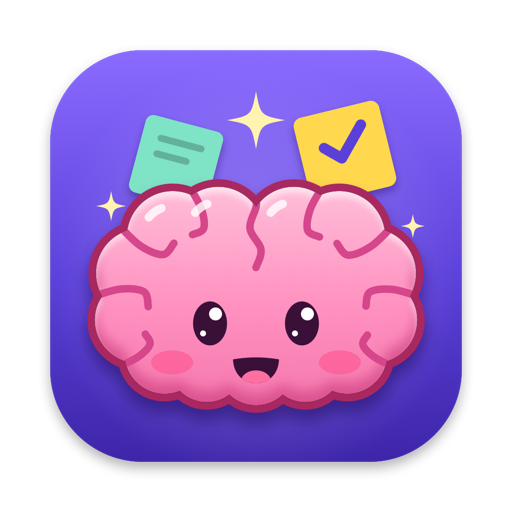
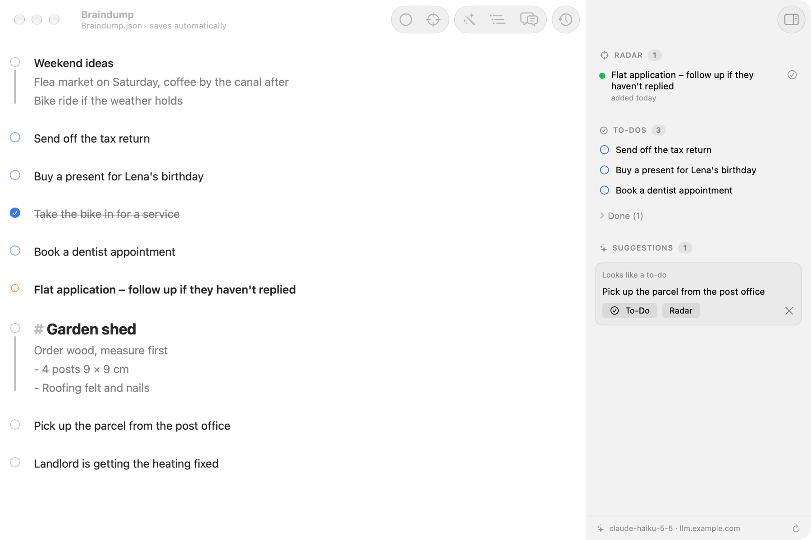

<p align="center">
  
</p>

<h1 align="center">Braindump</h1>

<p align="center">
  <b>A scratchpad for dumping thoughts.</b><br>
  It looks and feels like a plain text file, but it knows notes, to-dos and the things you want to keep on your radar.
</p>

<p align="center">
  <a href="../../releases/latest"></a>
</p>

<p align="center">
  <sub>Version 0.1 · macOS 26 or later · Apple silicon · free · a private, non-commercial project</sub>
</p>

<p align="center">
  <picture>
    <source media="(prefers-color-scheme: dark)" srcset="docs/screenshot-dark.png">
    
  </picture>
</p>

## Highlights

- ✍️ **Just type.** No save button, no folders. Lines that sit together are one note, and a blank line starts the next one.
- ✅ **To-dos and radar.** Turn any note into a to-do with ⌘↩, or put it on your radar with ⇧⌘↩. Radar is for things other people are working on that you only want to check every few days.
- ✨ **Suggestions.** A model notices when a note looks like a to-do or a radar item and offers to convert it. By default it's a small model that runs on your Mac.
- 🪄 **AI on one click (optional).** Connect any OpenAI-compatible server (for example a LiteLLM proxy) and pick a small, fast model. **Tidy Up** turns a dictated, rambling note into a clear title with details. **Extract To-Dos** turns meeting notes or a pasted thread into separate to-dos and radar items. **Ask Braindump** (⌘K) answers questions about all your notes.
- 🕘 **History.** Wrote something and deleted it again? ⌘Y shows what changed in the last hours, puts deleted notes back or restores a whole version.
- 🔗 **Jira and Notion previews.** A link at the end of a line shows the ticket's or page's status and title.
- 📄 **Your notes stay readable.** Everything lives in one JSON file in Documents. You can edit it by hand, and Braindump picks up the changes live.

## Install

1. Download `Braindump.zip` from the [latest release](../../releases/latest).
2. Unzip it and drag **Braindump** into **Applications**.
3. Open it once. Braindump isn't from the App Store and isn't notarized, so macOS blocks it the first time. Go to **System Settings → Privacy & Security** and click **Open Anyway**.

Or [build it yourself](#building-from-source).

## How it works

1. **Notes are blocks.** Lines directly below each other form one note: the first line is the title, the rest are details (quieter, connected by a line on the left). A blank line starts a new note.
2. **The icon left of a note shows its type:**
   - dashed circle = note
   - blue circle = to-do
   - blue check = done
   - orange crosshair = radar

   Clicking it does this:
   - on a note: a small menu opens, where you pick **To-Do** or **Radar**,
   - on a to-do: it gets checked off (another click reopens it),
   - on a radar item: a menu opens with **Checked Today**, **Make It a To-Do** and **Take Off the Radar**.

   Right-click any icon to pick any type.
3. **Radar** items sit at the top of the sidebar with a status dot. It turns from green to orange after a few days (you choose how many) and red three days later. The ✓ button resets the timer, the × (shown on hover) takes the item off the radar. The Dock icon shows how many are due.
4. **To-dos** are listed in the sidebar below the radar. Done ones collapse under "Done" and can be archived.
5. **Select several lines** and a small pop-up appears:
   - **Merge into one note** (the first one stays the title, the others become details)
   - **Split into separate notes**
   - make the selected notes **to-dos** or put them on the **radar**
6. **Suggestions.** When you leave a line, a model looks at each note's title. If it looks like a to-do or like something for your radar, a suggestion appears in the sidebar. The model is:
   - the AI server you set up, if you did (see [below](#connecting-an-ai-server)),
   - otherwise Apple Intelligence when it's available,
   - otherwise a tiny model of its own (about 1.3 MB, Apple frameworks only). It trains once on first launch (~30 s) and then learns from what you mark, accept or dismiss.

   The ↻ button at the bottom of the sidebar looks at all notes again.
7. **AI actions** (once an AI server is set up). They're in the toolbar (wand, list and speech bubbles, between the to-do/radar buttons and History), in the Note menu, in the right-click menu of a note's icon and in the pop-up over selected lines:
   - **Tidy Up (⌃⌘T)** rewrites the note at the cursor as a short title plus detail lines. It fixes dictation mistakes and keeps the language, every name, number and link.
   - **Extract To-Dos (⌃⌘E)** reads the selected text (or the note at the cursor) and adds what's in it as separate notes below it: to-dos, radar items and notes worth keeping. The original stays.
   - **Ask Braindump (⌘K)** answers a question about your notes ("What am I waiting on?") and links the notes it's based on.

   While the AI works, the note's icon turns into a pulsing sparkle. If you edit the note in the meantime, the answer is thrown away instead of overwriting your text. Every change can be undone with ⌘Z.
8. **Jira and Notion.** A Jira or Notion link at the end of a line gets a pill with its status and title. The radar and to-do lists show it too. Statuses are refreshed about every 5 minutes while Braindump runs. This needs a token once, see [below](#connecting-jira-and-notion).
9. **History (⌘Y or the clock in the toolbar).** Braindump keeps every version of your notes from the last 24 hours (1 hour to 7 days in Settings), and always at least the last 1,000, however old. A version is taken after a pause in typing, and always right before text gets deleted. Each version shows what changed: added, deleted and edited notes, line by line, and type changes. **Put Back** returns a deleted note to its old place, **Restore This Version** brings back everything (undo with ⌘Z).

Braindump saves shortly after you type, when you switch apps, and when you quit. The editor uses a monospaced font (SF Mono) by default; pick another font in Settings. The sidebar lists your notes in the same font. Copying from the editor gives plain text.

### Typing shortcuts

- `[ ] ` at the start of a line turns it into a to-do, `[x] ` into a done to-do, and `🚧 ` puts it on the radar. The characters disappear right away; only the icon shows the type.
- ↩ at the end of a one-line to-do starts the next to-do. ↩ again on the empty line ends the list.
- ↩ in a `- bullet` line continues the list.

### Keyboard shortcuts

| Shortcut | Action |
|---|---|
| ⌘↩ | Note → to-do → done → to-do |
| ⇧⌘↩ | Radar on/off |
| ⌥⌘↩ | Back to a plain note |
| ⌘J | Merge the selected lines into one note |
| ⇧⌘J | Split the selected lines into separate notes |
| ⌘Z / ⇧⌘Z | Undo / redo (text and type changes) |
| ⌘Y | History |
| ⌃⌘T | Tidy Up (AI) |
| ⌃⌘E | Extract To-Dos (AI) |
| ⌘K | Ask Braindump (AI) |
| ⌥⌘I | Show/hide the sidebar |
| ⌘F | Find |
| ⌘, | Settings |

## Connecting Jira and Notion

Both live in **Settings (⌘,) → Connections**. Tokens are stored in the macOS Keychain.

- **Jira:** enter your Jira site (e.g. `your-company.atlassian.net`), your email and an [API token](https://id.atlassian.com/manage-profile/security/api-tokens). Then click "Save & Test". Only links to that site get a preview; the token is never sent anywhere else.
- **Notion:** create an [internal integration](https://www.notion.so/profile/integrations) and paste its token. Then give pages access: open a page → ••• → Connections → your integration. Doing it on a top-level page covers everything below it.

Until a connection is set up, the link shows "Connect Jira …" / "Connect Notion …". Clicking it opens the settings.

## Connecting an AI server

The AI features are optional and off until you set them up in **Settings (⌘,) → Connections → AI Server**:

1. Enter the address of any OpenAI-compatible server: a [LiteLLM](https://github.com/BerriAI/litellm) proxy, OpenAI, or a model server on your Mac (plain `http://` only works for `localhost`).
2. Paste an API key if the server needs one. It's stored in the macOS Keychain.
3. Click "Save & Test". Braindump lists the server's models; pick a small, fast one (Haiku-, mini- or flash-class models work well).

Braindump asks for structured JSON answers with low reasoning effort. If a model doesn't support one of these options, Braindump retries without it.

What gets sent: the titles (and first detail lines) of plain notes for suggestions, the note or selection you run Tidy Up or Extract To-Dos on, and all notes of the file when you ask a question. Nothing else, and nothing at all without a server.

## Where your data lives

Nothing leaves your Mac, except the Jira and Notion lookups and the AI server you set up yourself.

Your notes are readable JSON in `~/Documents/Braindump/Braindump.json`, one entry per note:

```json
{
  "type" : "radar",
  "title" : "New onboarding flow",
  "details" : [
    "https://your-company.atlassian.net/browse/APP-123",
    "Backend done, iOS missing"
  ],
  "created" : "2026-11-06T14:12:20Z",
  "lastChecked" : "2026-11-06T18:00:00Z",
  "id" : "…"
}
```

- `type` is `note`, `todo`, `done` or `radar`.
- `spaceBefore` only appears when there isn't exactly one blank line before the note.
- You can edit the file by hand; Braindump picks up outside changes live.
- `Braindump-Archive.json` appears once you use "Archive Done".
- Settings → "Choose Another File…" opens another Braindump file or imports a plain text file.

`~/Library/Application Support/Braindump/` holds the daily backups (last 30), the history (`History/`, plain copies of the notes file, removed once they're older than the time set in Settings and not among the last 1,000), the trained mini model, what you taught it, the suggestions you dismissed and the link preview cache.

## Building from source

Requirements: macOS 26+, Xcode with Swift 6.2+. No Xcode project needed, it's a Swift package.

```bash
./build.sh --install
```

This builds the app (release, ad-hoc signed, no developer account needed), copies it to `~/Applications/Braindump.app` and launches it. Without `--install` it only lands in `build/`.

`Tools/ui_test.sh` runs a test copy in the background (its own notes file) through a series of edits and checks the window for drawing glitches.

Because the ad-hoc signature changes with every build, macOS asks again for access to Documents after each rebuild, and the Keychain asks once for your password. Signing with your own certificate avoids that:

```bash
SIGN_ID="Apple Development: Your Name (TEAMID)" ./build.sh --install
```

## About

Braindump is a private, non-commercial hobby project: no ads, no sales, no tracking. It's provided free of charge and without warranty. Mac and macOS are trademarks of Apple Inc.; this project isn't affiliated with Apple.

Found a bug or have an idea? [Open an issue](../../issues).
